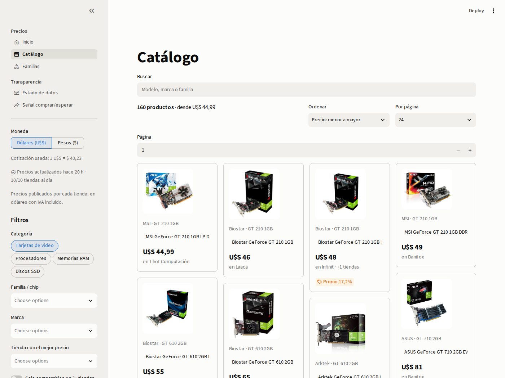
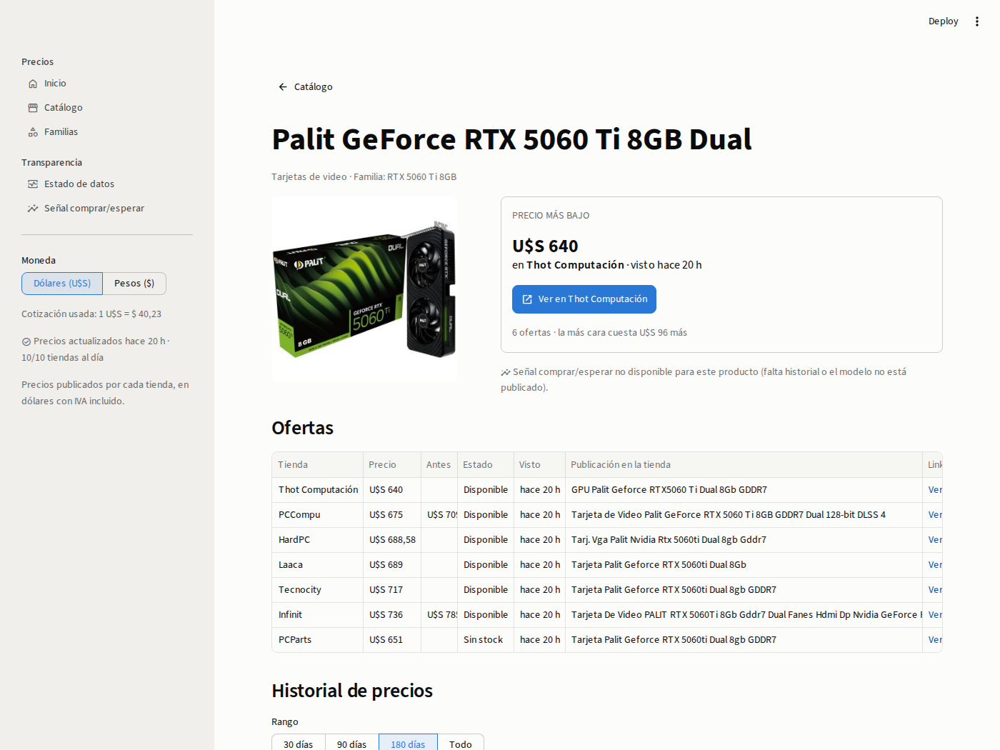

# Hardware Pulse

Exact-product price comparator for PC hardware in Uruguay (GPUs, CPUs, RAM and
SSDs), in the spirit of [preciospc.uy](https://preciospc.uy). It scrapes 10 local
stores twice a day, groups their listings into the **same exact product**
(brand + line + specs), keeps a compact price history per offer and shows the
lowest in-stock price, every store's offer and a 180-day history in a Spanish
Streamlit app. An experimental "¿comprar o esperar?" signal is published only
when it beats a simple baseline in an honest backtest.

| Catálogo | Producto |
|---|---|
|  |  |

> v2 is a rewrite. The v1 design (chip-level grouping, weekly medians,
> ElasticNet forecasts) and the audit that motivated the rewrite are kept in
> [`docs/legacy/`](docs/legacy/) and summarized in [`docs/decisions.md`](docs/decisions.md).

## How it works

```
GitHub Actions (cron 09:00 and 17:00 UYT)
  └─ python -m src.cli run
       scrape    → 3 platform adapters, 10 stores → listings + price_periods + scrape_runs
       resolve   → strict per-category spec parsers → products (exact) / families (chip/model)
       aggregate → quality_issues, product_daily, family_daily, product_stats
       signals   → buy/wait model (weekly retrain, published only if it beats the baseline)
  └─ uploads hardware_pulse.db.gz + status.json to the "data-latest" Release
Streamlit app → downloads data-latest (cached 1 h) → Spanish UI
```

### Stores

| Platform adapter | Stores | Source |
|---|---|---|
| `woocommerce` | Thot Computación, Laaca, NetPC, Obsidian, PCParts, Tecnocity | WooCommerce Store API (JSON) |
| `sme` | PCCompu, HardPC, Infinit | Shared HTML storefront platform |
| `nopcommerce` | Banifox | nopCommerce HTML |

Stores and their category URLs live in [`configs/stores.yaml`](configs/stores.yaml);
`python -m src.cli discover-categories <store>` helps fill it in.

### Data model (SQLite)

- `listings`: one row per store URL, with condition (new / open box / used…),
  first and last seen, active flag and the product it resolves to.
- `price_periods`: change-based history. A period is extended while
  price, regular price and stock stay the same and a new one opens when any of
  them changes. Re-running the same day changes nothing.
- `scrape_runs`: every store × category run, classified `ok`, `empty`,
  `anomaly` or `error`. Listings are only delisted after an `ok` run, so a
  broken store never wipes its offers.
- `products` / `families`: the exact product (fingerprint) and its family
  (GPU chip + VRAM, CPU model, RAM type + capacity + speed + form factor,
  SSD interface + capacity).
- Derived tables, rebuilt on every run: `quality_issues`, `product_daily`,
  `family_daily`, `product_stats`, `signals`, `model_registry`.

A product's **current price** is the lowest USD price among offers that are
active, new, not out of stock, seen in their store's last successful run
(≤ 72 h ago) and free of quality issues (implausible prices are flagged and
excluded).

### Entity resolution

No fuzzy matching. Each category has a strict spec parser in
[`src/entities/specs/`](src/entities/specs/) (exact GPU chip suffixes such as Ti / Super /
XT, CPU model + suffix, RAM kit / speed / DIMM vs SODIMM, SSD capacity / interface /
form factor) plus brand, line and modifier vocabularies in
[`configs/taxonomy.yaml`](configs/taxonomy.yaml) and manufacturer part numbers. When the
line is not recognized the listing stays in its family as a product of its own:
**it is never merged by guessing**. A versioned gold set of ≥ 250 real titles
([`tests/fixtures/resolution_gold.yaml`](tests/fixtures/resolution_gold.yaml)) gates CI:
family precision ≥ 0.98, recall ≥ 0.90, product precision ≥ 0.95.
`python -m src.cli qa-report` renders every product group for manual review.

### Buy/wait signal

For each product with ≥ 21 days of history, a logistic regression estimates
the probability that the lowest price drops ≥ 5% in the next 14 days, using
point-in-time features (recent returns, distance to 30/90-day min/median/max,
volatility, offers, position within its family, family momentum, category,
Black Friday window). It is evaluated walk-forward with a 14-day purge against
a baseline (drop rate per category × above/below the 30-day median) and
**published only if Brier skill > 0 and PR-AUC > base rate**. The model is
stored as JSON (no pickle). The "Señal" page shows the latest backtest even when
the gate keeps it unpublished, which is the case with the current history.

### ¿Comprar acá o importar?

Each product page shows the US price below which importing is worth it, and a
calculator with the landed cost line by line: US sales tax, courier freight by weight
band, TFSPU, handling, card fee and the Uruguayan tax under the 2026 regime (franchise of
3 shipments / USD 800 per year with 22% IVA and a USD 20 minimum, no tax for US
registered sellers up to USD 200, 60% single tax otherwise). The "Importar" page also
plans several products at once: an exact optimizer decides what to buy here, what to
import and how to split it into shipments, including relatives' franchises. US prices
are typed by the user or sent by a bookmarklet from Amazon, Newegg, B&H or Best Buy; no
store is scraped and no paid API is used. Rules, tariffs and their sources live in
`configs/` and are documented in [`docs/importacion.md`](docs/importacion.md).

## Running it

```bash
uv sync                                   # Python 3.11, dependencies from uv.lock
uv run python -m src.cli pull-data        # latest published database
uv run streamlit run streamlit_app.py     # dashboard on http://localhost:8501

uv run python -m src.cli run              # full pipeline (scrape → resolve → aggregate → signals)
uv run python -m src.cli scrape --dry-run --stores thot --categories gpu
uv run python -m src.cli status           # data health per store and category
```

Exit codes: `0` ok, `2` degraded (a store or category failed; its offers are
kept), `1` fatal. `HP_DB_PATH` overrides the database location and `HP_DATA_URL`
the published database URL.

## Operations

- [`.github/workflows/scrape.yml`](.github/workflows/scrape.yml) runs the pipeline at
  12:00 and 20:00 UTC, republishes the database to the `data-latest` Release and
  keeps a 30-day artifact backup. Degraded runs fail the job, so GitHub sends
  an email. A monthly keepalive stops GitHub from disabling the schedule.
- [`.github/workflows/ci.yml`](.github/workflows/ci.yml): ruff, pyright, offline unit tests
  (store fixtures, gold set, pipeline rules, ML) and Playwright E2E against a
  synthetic database.
- Streamlit Community Cloud: entrypoint `streamlit_app.py`, dependencies from
  `requirements.txt` (`uv export --no-dev --no-hashes --no-emit-project`).

## Development

```bash
uv run ruff check . && uv run ruff format --check .
uv run pyright
uv run pytest                        # offline
uv run pytest -m e2e tests/e2e       # dashboard (needs `playwright install chromium`)
uv run pytest -m live                # optional smoke test against the real stores
```

Project layout: `src/scrapers` (adapters), `src/entities` (parsers, taxonomy, MPN,
resolver), `src/storage` (SQLite, migrations, repository), `src/pipelines`
(scrape, resolve, aggregate, FX, status, legacy import, QA report), `src/ml`
(dataset, models, backtest, signals) and `src/dashboard` (data access, components, pages).

## License

MIT
